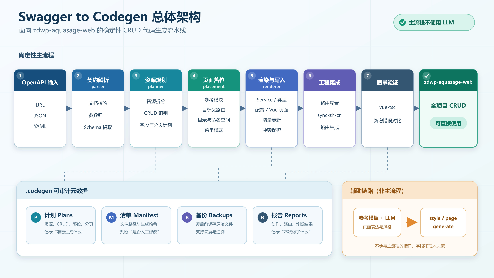

# Swagger to Codegen

> 面向 `zdwp-aquasage-web` 的 OpenAPI CRUD 前端代码生成工具

`swagger-to-codegen` 将 Swagger/OpenAPI 契约转换为 `zdwp-aquasage-web` 可直接使用的 API、类型、字段配置和 Vue 页面。项目的目标不是做一套适配所有前端工程的通用生成器，而是把 AquaSage 各父路由下高度重复的 CRUD 开发流程固化为命令行工具。

| 项目属性 | 当前说明                                                           |
| -------- | ------------------------------------------------------------------ |
| 服务对象 | `zdwp-aquasage-web`                                                |
| 核心场景 | 在任意 AquaSage 父路由下生成同结构 CRUD 页面                       |
| 主要输入 | OpenAPI 3.x / Swagger 2.0，支持 URL、本地 JSON 和 YAML             |
| 主要输出 | Service API、TypeScript 类型、字段配置、列表页、详情页、可选附件页 |
| 推荐命令 | `aquasage`                                                         |
| 设计原则 | 能由契约和项目规范确定的内容全部由脚本生成                         |
| LLM 依赖 | AquaSage 主流程不依赖；参考模板实验流程依赖                        |
| 当前版本 | `3.1.0`                                                            |
| Node.js  | `>= 20.19.0`                                                       |

## 1. 项目背景与目标

### 1.1 要解决的问题

`zdwp-aquasage-web` 中存在大量结构相同的 CRUD 页面。它们通常共享：

- 相同的工程目录和路由层级；
- 相同的请求封装、分页表格和表单组件；
- 相同的新增、编辑、详情、删除交互；
- 相同的代码风格和类型命名空间；
- 不同的业务接口、业务字段、标题和少量能力开关。

手工复制页面再替换字段容易产生接口漏改、类型缺失、分页路径错误、路由标题遗漏和覆盖人工代码等问题。

### 1.2 项目目标

本项目把可重复工作转换为一条可审计的生成流水线：

```text
OpenAPI 契约
  → 识别业务资源
  → 判断 CRUD 能力
  → 推导字段、分页和响应路径
  → 按 AquaSage 目录与组件约定渲染
  → 格式化、增量写入、路由处理、类型检查
  → 得到可直接进入业务项目的代码
```

### 1.3 项目边界

- 生成规范以 `zdwp-aquasage-web` 为唯一目标，不为其他项目牺牲目录、组件或调用约定。
- `aquasage` 是生产使用的主流程，采用确定性渲染，不调用 LLM。
- `style`、`page`、`generate` 是保留的“参考模板 + LLM”辅助流程，不是 AquaSage 专用生成的首选方案。
- `engineering-catalog` 是向后兼容的默认预设；通过参考模块和目标父路由参数，可生成到 AquaSage 的其他业务模块。
- “参考模块”只用于识别 AquaSage 已有页面的目录、Service、字段配置和菜单模式，不会把任意 Vue 文件当字符串复制，也不会改变本工具只服务 AquaSage 的边界。

## 2. 核心价值

| 传统方式                   | 使用本工具                         |
| -------------------------- | ---------------------------------- |
| 复制已有页面后逐项替换     | 从 OpenAPI 自动识别接口和字段      |
| 人工编写 API 与类型        | 自动生成并闭包补齐引用类型         |
| 人工判断分页数据路径       | 自动分析 records 与 total 路径     |
| 人工新增字段配置和表单校验 | 根据 Schema 生成控件与校验         |
| 人工维护路由标题           | 支持配置式路由和 i18n 路由两种方案 |
| 重复执行可能覆盖人工修改   | 基于哈希识别冲突，默认保留人工文件 |
| 只能看到最终文件           | 保留计划、清单、备份和运行报告     |

一次完整的 AquaSage 资源生成通常可产出 5 个文件；启用且满足附件条件时产出 6 个文件。

## 3. 总体架构



高清 JPG 可单独用于项目汇报；SVG 源文件保留在 `docs/images/swagger-to-codegen-architecture.svg`，便于后续修改文字和版式。

### 3.1 分层说明

| 层级            | 核心模块                                                          | 职责                                                    |
| --------------- | ----------------------------------------------------------------- | ------------------------------------------------------- |
| CLI 层          | `codegen.js`                                                      | 定义命令、参数校验、组织执行流程                        |
| 契约层          | `lib/parser.js`                                                   | 读取远程或本地文档，兼容 JSON/YAML、OpenAPI/Swagger     |
| 通用生成层      | `generator.js`、`contractAnalyzer.js`、`uiPlanner.js`             | API、类型、CRUD 证据和通用 UI Plan                      |
| AquaSage 规划层 | `lib/aquasage/planner.js`                                         | 按稳定资源路径拆分接口并建立资源计划                    |
| 页面落位层      | `lib/aquasage/placementResolver.js`                               | 分析参考模块并确定父路由、目录、命名空间和菜单模式      |
| AquaSage 渲染层 | `lib/aquasage/renderer.js`                                        | 输出符合目标项目约定的 service、typing、配置和 Vue 页面 |
| 工程集成层      | `projectGenerator.js`、`routePatcher.js`、`localeSynchronizer.js` | 写入目标工程、处理两种路由版本、生成报告                |
| 质量保障层      | `incrementalWriter.js`、`validator.js`、`formatCode.js`           | 路径保护、冲突检测、备份、格式化和类型诊断              |
| LLM 辅助层      | `styleAnalyzer.js`、`pageGenerator.js`                            | 分析参考模板、生成实验性页面并限次修复                  |

### 3.2 两条执行链

#### A. AquaSage 专用确定性链路（推荐）

```text
aquasage
  ├─ parser
  ├─ AquaSage planner
  ├─ placement resolver
  ├─ AquaSage renderer
  ├─ incremental writer
  ├─ route patch / route generation
  └─ vue-tsc diagnostic diff
```

特点：不使用 LLM、输出稳定；业务字段由 OpenAPI 决定，代码落到哪里由 AquaSage 页面落位参数决定。

#### B. 通用模板辅助链路（保留能力）

```text
api / analyze / plan
  → API + 模块类型 + UI Plan
  → style / page / generate
  → 参考模板 + LLM 页面
```

特点：适合验证模板生成思路；页面表达依赖模型输出，稳定性低于专用链路。

## 4. 工作原理

### 4.1 契约读取与规范化

`loadSwagger` 根据输入自动选择读取方式：

- `http://` 或 `https://`：通过网络读取，超时时间 15 秒；
- 本地文件：直接读取文件内容；
- JSON：按 JSON 解析；
- `.yaml`、`.yml` 或 YAML 内容：按 YAML 解析；
- 同时支持 OpenAPI 3 的 `components.schemas` 和 Swagger 2 的 `definitions`；
- 合并 path 级与 operation 级参数；
- 兼容 Swagger 2 的 body 参数和 OpenAPI 3 的 `requestBody`；
- 从第一个 2xx 响应中提取响应 Schema。

### 4.2 业务资源拆分

一个 Swagger tag 可能包含多个业务实体，因此 AquaSage 主流程不会简单地把一个 tag 当成一个页面。规划器会去掉路径末尾的动作段，例如：

```text
/api/v1/hyo/river/page
/api/v1/hyo/river/detail
/api/v1/hyo/river/update
/api/v1/hyo/river/delete
```

这些接口会归并为稳定资源：

```text
/api/v1/hyo/river
```

因此，“水体相关”一个 tag 可以继续拆分为 `river`、`lake`、`fish-survey` 等多个独立页面。

### 4.3 CRUD 能力识别

规划器综合以下证据为每个资源选择 list、detail、create、update、delete 接口：

- HTTP 方法；
- URL 末段；
- `operationId`；
- summary/description 关键词；
- 是否包含路径参数或详情查询参数。

列表接口是专用页面生成的最低要求。其他接口缺失时会输出复核警告，并在页面中省略对应的 API 能力或操作。

### 4.4 Schema 到 UI 计划

脚本继续从请求和响应 Schema 推导：

- 查询条件：来自列表接口的 query 参数，排除分页、排序等系统参数；
- 表格字段：来自列表响应项，优先常用业务字段并限制展示数量；
- 表单字段：来自新增或更新请求体，排除 id、时间戳、版本等系统字段；
- 控件类型：enum → select、boolean → switch、date → 日期控件、number → 数字控件、长文本 → textarea；
- 特殊字段：`city_code`、`area_code` 使用 AquaSage 树形区域控件约定；
- 校验规则：required、长度、数值范围和 pattern；
- 分页参数：识别 current/page/page_num 与 size/page_size/limit；
- 响应路径：识别 data/result/payload 包装以及 records/rows/list/items/content、total/count 等结构；
- 详情主键：优先 `project_code`、`std_code`、`id`、`code`。

计划会保存到 `.codegen/aquasage/plans/<slug>.json`，便于检查脚本为何生成某个字段或调用。

### 4.5 页面落位解析

资源计划只描述“生成什么”，页面落位层描述“生成到哪里”。两者分开后，同一套 CRUD 能力可以安装到 AquaSage 的不同父路由，而不用把工程名录路径写死在渲染器中。

落位层依次处理：

1. `--reference-view`：静态检查参考模块是否属于当前支持的 AquaSage 分页 CRUD 模式；
2. `--target-parent`：确定新资源所属的父路由；
3. 从参考模块推断 Service 分组、字段配置分组和菜单显示方式；
4. 由目标路由推导 view 路径、路由名和组件名；
5. 允许通过 `--service-group`、`--type-group`、`--config-group`、`--type-namespace` 显式覆盖推断结果；
6. 当 `--create-parent` 启用时，为新父路由补充中文标题和菜单元数据。

参考页面必须位于目标项目的 `src/views` 内，并至少包含 `list/index.vue`、`NDataTable` 和 AquaSage 分页表格 composable。该检查完全由脚本执行，不调用 LLM。

### 4.6 AquaSage 专用渲染

渲染器不复制任意项目模板，而是固定使用 `zdwp-aquasage-web` 的工程约定：

- `@/service/request` 请求体系；
- `Api.<业务分组>` 类型命名空间；工程名录默认仍为 `Api.EngineeringCatalog`；
- `EngineeringForm` 等公共组件；
- `useNaivePaginatedTable` 等现有 composable；
- 由落位计划指定的 AquaSage 路由与页面层级。

这也是生成结果能够直接进入目标项目的关键。

### 4.7 写入与校验

正式生成时依次执行：

1. 验证目标项目 `package.json.name === "zdwp-aquasage-web"`；
2. 检查请求封装、公共表单组件和列表 composable 等项目标志文件；
3. 使用目标文件所在项目的 Prettier 配置格式化；
4. 记录生成前的 `vue-tsc` 错误基线；
5. 通过增量写入器创建、更新或保护文件；
6. 按目标项目版本处理路由；
7. 保存资源计划和运行报告；
8. 再次运行 `vue-tsc`，只拦截本次新增的类型错误。

## 5. 项目目录

```text
swagger-to-codegen/
├─ codegen.js                         # 统一 CLI 入口，推荐使用
├─ index.js                           # 早期单一 API 生成入口，保留兼容，不推荐
├─ lib/
│  ├─ parser.js                       # OpenAPI/Swagger 读取与标准化
│  ├─ generator.js                    # 通用 API 与 TypeScript 类型生成
│  ├─ contractAnalyzer.js             # CRUD 角色、证据、置信度与覆盖率
│  ├─ uiPlanner.js                    # 通用确定性 UI Plan
│  ├─ incrementalWriter.js            # 哈希基线、冲突、备份、原子写入
│  ├─ extractSkeletonFromFiles.js     # 从 API 和模块类型提取页面骨架
│  ├─ styleAnalyzer.js                # LLM 分析参考页面风格
│  ├─ pageGenerator.js                # LLM 页面生成与限次修复
│  ├─ formatCode.js                   # Vue 格式化与临时类型检查
│  └─ aquasage/
│     ├─ planner.js                   # AquaSage 资源计划
│     ├─ placementResolver.js         # 参考模块、目标父路由和目录落位
│     ├─ renderer.js                  # AquaSage 文件渲染
│     ├─ projectGenerator.js          # 专用生成总流程
│     ├─ validator.js                 # 目标工程及类型诊断
│     ├─ routePatcher.js              # route-titles/menu-config 路由版本
│     └─ localeSynchronizer.js        # Elegant Router + zh-cn i18n 版本
├─ templates/List.vue                 # 示例参考模板
├─ test/                              # Node.js 自动化测试
├─ docs/
│  ├─ deterministic-pipeline.md       # 确定性流水线设计说明
│  └─ patent-technical-disclosure.md  # 技术交底材料
├─ style-guide.yaml                   # 示例风格规范
└─ package.json                       # 包信息与 aquasage-codegen 命令注册
```

## 6. AquaSage 生成结果

不传页面落位参数时，工具保持旧行为。以资源 `river` 为例，默认写入工程名录：

```text
zdwp-aquasage-web/
├─ src/service/api/engineering-catalog/river.ts
├─ src/typings/api/engineering-catalog/river.d.ts
├─ src/config/engineering/river-fields.ts
└─ src/views/knowledge-engineering/engineering-catalog/river/
   ├─ list/index.vue
   ├─ detail/index.vue
   └─ attachment/index.vue            # 仅启用且存在引用字段时生成
```

如果指定：

```text
--reference-view src/views/knowledge-engineering/spatial-element/river-system/rivers
--target-parent /knowledge-engineering/spatial-element/river-system
```

同一个资源会改为写入：

```text
zdwp-aquasage-web/
├─ src/service/api/spatial-element/river.ts
├─ src/typings/api/spatial-element/river.d.ts
├─ src/config/engineering/river-fields.ts
└─ src/views/knowledge-engineering/spatial-element/river-system/river/
   ├─ list/index.vue
   └─ detail/index.vue
```

具体目录与命名空间会记录在 `.codegen/aquasage/plans/<slug>.json` 的 `placement` 字段中。

同时生成审计元数据：

```text
zdwp-aquasage-web/.codegen/
├─ manifest.json
├─ reports/
├─ conflicts/
├─ backups/
└─ aquasage/
   ├─ plans/
   ├─ reports/
   └─ backups/
```

`.codegen` 不属于业务源码，但它是增量生成的可信基线，不建议删除。

## 7. 命令选择

先根据当前目标选择功能线，不需要从参数字典开始阅读。

| 我现在想做什么                           | 使用命令     |
| ---------------------------------------- | ------------ |
| 直接给 `zdwp-aquasage-web` 生成正式 CRUD | `aquasage`   |
| 检查 Swagger 的 CRUD 是否完整            | `analyze`    |
| 检查准备生成哪些字段和控件               | `plan`       |
| 同步 Elegant Router 路由和 `zh-cn.ts`    | `sync-zh-cn` |
| 运行旧版 API 生成脚本                    | `index.js`   |
| 只生成通用 API 和类型                    | `api`        |
| 分析参考 Vue 页面的风格                  | `style`      |
| 根据已有 API 生成 Vue 页面               | `page`       |
| 一次生成通用 API、类型和页面             | `generate`   |

项目命令分为三条功能线：

1. **AquaSage 推荐主流程**：`analyze`、`plan`、`aquasage`、`sync-zh-cn`。
2. **兼容旧入口**：`index.js`，以及兼容保留的 `api -t` 合并写法。
3. **通用模板实验功能**：`api`、`style`、`page`、`generate`。

查看当前版本和命令帮助：

```powershell
node .\codegen.js --version
node .\codegen.js --help
node .\codegen.js aquasage --help
```

如果以依赖包方式安装到业务项目，只需把命令前缀：

```powershell
node .\codegen.js
```

替换为：

```powershell
pnpm exec aquasage-codegen
```

子命令和参数保持不变。

## 8. 第一条功能线：AquaSage 推荐主流程

适用于最终目标是直接完善 `zdwp-aquasage-web` 的场景。

推荐执行顺序：

```text
analyze（可选）
    ↓
plan（可选）
    ↓
aquasage --dry-run
    ↓
aquasage 正式生成
    ↓
sync-zh-cn（Elegant Router 项目需要）
```

### 8.1 场景一：检查 Swagger 的 CRUD 是否完整

如果后端刚提供 OpenAPI，你想先检查是否包含列表、详情、新增、修改和删除接口，使用 `analyze`。

#### 命令格式

```powershell
node .\codegen.js analyze -s <OpenAPI地址或文件> -o <报告文件>
```

#### 参数说明

- `-s, --swagger <url-or-file>`：OpenAPI URL 或本地 JSON/YAML 文件，必填。
- `-o, --output <path>`：分析报告输出路径，默认 `codegen-plan.json`。

#### 完整示例：分析 Swagger 的 CRUD 完整度

```powershell
node .\codegen.js analyze `
  -s "http://19.19.12.206:8000/api/v1/openapi.json" `
  -o ".\codegen-plan.json"
```

#### 生成结果

```text
codegen-plan.json
```

报告包含：

- Swagger 模块和接口数量；
- list/detail/create/update/delete 判断结果；
- HTTP 方法、URL 和关键词等判断证据；
- 判断置信度；
- 每个模块的 CRUD 覆盖率。

这个命令只生成分析报告，不修改 `zdwp-aquasage-web`，不使用 LLM，也不需要 `--dry-run`。

### 8.2 场景二：检查页面准备使用哪些字段和控件

如果你想在生成页面前，检查脚本准备使用哪些查询字段、表格列、表单控件和分页路径，使用 `plan`。

#### 命令格式

```powershell
node .\codegen.js plan -s <OpenAPI地址或文件> -m <Swagger标签> -o <计划文件>
```

#### 参数说明

- `-s, --swagger <url-or-file>`：OpenAPI URL 或本地 JSON/YAML 文件，必填。
- `-m, --module <tag>`：只生成指定 Swagger tag 的计划；不填写时规划全部 tag。
- `-o, --output <path>`：UI Plan 输出路径，默认 `ui-plan.json`。

#### 完整示例：检查“水体相关”的页面字段

```powershell
node .\codegen.js plan `
  -s "http://19.19.12.206:8000/api/v1/openapi.json" `
  -m "水体相关" `
  -o ".\ui-plan-hyo.json"
```

#### 生成结果

```text
ui-plan-hyo.json
```

计划文件包含：

- 查询字段和表格列；
- 表单字段和输入控件；
- 必填校验；
- 分页参数；
- 列表数据和总数响应路径；
- CRUD 接口绑定关系。

这个命令只生成计划 JSON，不生成 Vue 页面，不修改 AquaSage，也不使用 LLM。

### 8.3 场景三：直接生成 AquaSage CRUD

如果你想根据 Swagger tag，直接在 `zdwp-aquasage-web` 中生成 Service、类型、字段配置和 Vue 页面，使用 `aquasage`。

#### 命令格式

```powershell
node .\codegen.js aquasage `
  -s <OpenAPI地址或文件> `
  -p <zdwp-aquasage-web目录> `
  -m <Swagger标签> `
  [其他参数]
```

#### 基础参数说明

- `-s, --swagger <url-or-file>`：OpenAPI URL 或本地 JSON/YAML 文件，必填。
- `-p, --project <dir>`：`zdwp-aquasage-web` 项目根目录，必填。
- `-m, --module <tag>`：按照 Swagger tag 选择资源。
- `-r, --resource <base-path>`：按照完整 API 资源路径选择一个资源。
- `--slug <name>`：按照资源 URL 最后一段选择一个资源。
- `--all`：选择 OpenAPI 中全部可识别资源。
- `--title <text>`：覆盖单个资源的中文名称。
- `--with-attachment`：满足条件时生成附件页面。
- `--dry-run`：只预览资源、路由和文件，不写任何文件。
- `--force`：备份后覆盖检测到人工修改的文件。
- `--no-routes`：不修改配置式路由文件。
- `--no-route-generation`：不执行目标项目的路由生成命令。
- `--no-check`：不执行生成前后的 `vue-tsc` 新增错误检查。

以下资源选择参数至少填写一个：

```text
--resource
--module
--slug
--all
```

#### 第一步：安全预览“水体相关”

```powershell
node .\codegen.js aquasage `
  -s "http://19.19.12.206:8000/api/v1/openapi.json" `
  -p "D:\workCode\知识库\2026-08-10-1\zdwp-aquasage-web" `
  -m "水体相关" `
  --dry-run
```

这一步会输出：

```text
识别到哪些业务资源
每个资源使用哪个 API 基础路径
每个资源准备生成到哪个父路由
准备创建或更新哪些文件
缺少哪些 CRUD 接口
```

不会写入业务文件、路由文件或 `.codegen` 元数据。

#### 第二步：正式生成“水体相关”

确认预览结果正确后，删除 `--dry-run`：

```powershell
node .\codegen.js aquasage `
  -s "http://19.19.12.206:8000/api/v1/openapi.json" `
  -p "D:\workCode\知识库\2026-08-10-1\zdwp-aquasage-web" `
  -m "水体相关"
```

#### 生成结果

“水体相关”tag 下可能包含多个资源，脚本会继续按照 API 基础路径拆分。

```text
zdwp-aquasage-web/
├─ src/service/api/engineering-catalog/
│  ├─ river.ts
│  ├─ lake.ts
│  └─ other-water.ts
├─ src/typings/api/engineering-catalog/
│  ├─ river.d.ts
│  ├─ lake.d.ts
│  └─ otherWater.d.ts
├─ src/config/engineering/
│  ├─ river-fields.ts
│  ├─ lake-fields.ts
│  └─ other-water-fields.ts
├─ src/views/knowledge-engineering/engineering-catalog/
│  ├─ river/
│  │  ├─ list/index.vue
│  │  └─ detail/index.vue
│  ├─ lake/
│  │  ├─ list/index.vue
│  │  └─ detail/index.vue
│  └─ other-water/
│     ├─ list/index.vue
│     └─ detail/index.vue
└─ .codegen/
   └─ aquasage/
      ├─ plans/
      ├─ reports/
      └─ backups/
```

实际文件以 Swagger 中识别到的资源和终端输出为准。

### 8.4 场景四：只生成一个指定资源

如果一个 Swagger tag 下有多个资源，但你只想生成“河流”，可以使用 `--resource` 或 `--slug`。

#### 按完整 API 路径选择

```powershell
node .\codegen.js aquasage `
  -s "http://19.19.12.206:8000/api/v1/openapi.json" `
  -p "D:\workCode\知识库\2026-08-10-1\zdwp-aquasage-web" `
  --resource "/api/v1/hyo/river" `
  --title "河流" `
  --dry-run
```

#### 按资源 slug 选择

```powershell
node .\codegen.js aquasage `
  -s "http://19.19.12.206:8000/api/v1/openapi.json" `
  -p "D:\workCode\知识库\2026-08-10-1\zdwp-aquasage-web" `
  --slug "river" `
  --title "河流" `
  --dry-run
```

#### 参数说明

- `--resource <base-path>`：资源的完整 API 基础路径。
- `--slug <name>`：API URL 最后一段，例如 `river`。
- `--title <text>`：该资源的中文名称。

`--title` 建议只与单资源的 `--resource` 或 `--slug` 一起使用。确认结果后删除 `--dry-run`。

### 8.5 场景五：模仿现有页面，生成到指定父路由

如果你不想生成到默认“工程名录”，而是想模仿“河流水系”下面的现有页面，并把新页面放到指定父路由，使用以下参数。

#### 参数说明

- `--reference-view <path>`：参考业务模块目录，或者其 `list/index.vue`。
- `--target-parent <route-path>`：新页面所属父路由。
- `--menu-mode <mode>`：菜单显示模式。
  - `reference`：模仿参考页面。
  - `resource`：每个资源显示为独立菜单。
  - `parent`：只显示父菜单，资源页面隐藏。
- `--active-menu <route-name>`：隐藏页面需要点亮的菜单路由名。

#### 完整示例：参考河流水系生成“渠道”

```powershell
node .\codegen.js aquasage `
  -s "http://19.19.12.206:8000/api/v1/openapi.json" `
  -p "D:\workCode\知识库\2026-08-10-1\zdwp-aquasage-web" `
  --resource "/api/v1/hyo/channel" `
  --title "渠道" `
  --reference-view "src/views/knowledge-engineering/spatial-element/river-system/rivers" `
  --target-parent "/knowledge-engineering/spatial-element/river-system" `
  --menu-mode reference `
  --dry-run
```

#### 预计生成位置

```text
src/views/knowledge-engineering/spatial-element/river-system/channel/
├─ list/index.vue
├─ detail/index.vue
└─ attachment/index.vue    # 满足条件且使用 --with-attachment 时生成
```

确认位置正确后删除 `--dry-run`。

### 8.6 场景六：创建新的父路由

如果目标父路由还不存在，需要添加 `--create-parent`。

#### 参数说明

- `--create-parent`：创建新的父路由分组。
- `--target-parent <route-path>`：新父路由路径，必填。
- `--parent-title <text>`：新父路由中文标题，必填。
- `--parent-icon <icon>`：新父路由图标。
- `--parent-order <number>`：新父路由菜单排序。
- `--parent-permission <key>`：新父路由权限码。
- `--permission <key>`：新资源权限码。
- `--order <number>`：新资源菜单排序。

#### 完整示例：创建“水文档案”父路由

```powershell
node .\codegen.js aquasage `
  -s "http://19.19.12.206:8000/api/v1/openapi.json" `
  -p "D:\workCode\知识库\2026-08-10-1\zdwp-aquasage-web" `
  --resource "/api/v1/hyo/channel" `
  --title "渠道" `
  --reference-view "src/views/knowledge-engineering/spatial-element/river-system/rivers" `
  --target-parent "/knowledge-engineering/hydrology-archive" `
  --create-parent `
  --parent-title "水文档案" `
  --parent-icon "mdi:archive-water" `
  --parent-order 8 `
  --menu-mode resource `
  --dry-run
```

使用 `--create-parent` 时：

- 必须同时提供 `--target-parent`；
- 必须同时提供 `--parent-title`；
- 新父路由的上级目录必须已经存在。

### 8.7 场景七：自定义代码输出分组

如果默认的 Service、类型和字段配置目录不符合目标父路由，可以手动指定。

#### 参数说明

- `--service-group <path>`：`src/service/api` 下的输出目录。
- `--type-group <path>`：`src/typings/api` 下的输出目录。
- `--config-group <path>`：`src/config` 下的输出目录。
- `--type-namespace <name>`：`Api` 下的 TypeScript 命名空间。
- `--attachment-service <path>`：附件 Service 导入路径。

#### 完整示例

```powershell
node .\codegen.js aquasage `
  -s "http://19.19.12.206:8000/api/v1/openapi.json" `
  -p "D:\workCode\知识库\2026-08-10-1\zdwp-aquasage-web" `
  --resource "/api/v1/hyo/channel" `
  --title "渠道" `
  --target-parent "/knowledge-engineering/hydrology-archive" `
  --service-group "hydrology-archive" `
  --type-group "hydrology-archive" `
  --config-group "hydrology" `
  --type-namespace "HydrologyArchive" `
  --dry-run
```

#### 预计生成位置

```text
src/service/api/hydrology-archive/channel.ts
src/typings/api/hydrology-archive/channel.d.ts
src/config/hydrology/channel-fields.ts
src/views/knowledge-engineering/hydrology-archive/channel/
```

### 8.8 场景八：同步 `zh-cn.ts` 中文标题

如果项目采用以下文件：

```text
src/router/elegant/routes.ts
src/locales/langs/zh-cn.ts
```

需要分两步执行。

#### 第一步：生成业务代码并跳过配置式路由

```powershell
node .\codegen.js aquasage `
  -s "http://19.19.12.206:8000/api/v1/openapi.json" `
  -p "D:\workCode\知识库\2026-08-10-1\zdwp-aquasage-web" `
  -m "水体相关" `
  --no-routes
```

#### 第二步：预览中文标题

```powershell
node .\codegen.js sync-zh-cn `
  -s "http://19.19.12.206:8000/api/v1/openapi.json" `
  -p "D:\workCode\知识库\2026-08-10-1\zdwp-aquasage-web" `
  -m "水体相关" `
  --dry-run
```

#### 第三步：正式生成路由并同步标题

```powershell
node .\codegen.js sync-zh-cn `
  -s "http://19.19.12.206:8000/api/v1/openapi.json" `
  -p "D:\workCode\知识库\2026-08-10-1\zdwp-aquasage-web" `
  -m "水体相关"
```

#### `sync-zh-cn` 特有参数

- `--titles <json-file>`：使用 JSON 批量指定资源中文标题。
- `--dry-run`：只检查标题，不生成路由、不修改文件。
- `--force`：覆盖已有人工中文标题。
- `--no-route-generation`：不执行 `pnpm exec sa gen-route`。
- `--with-attachment`：同步附件页面标题。

其他资源选择、参考页面、目标父路由和菜单参数，与 `aquasage` 含义相同。

如果 `aquasage` 使用了以下参数，`sync-zh-cn` 必须保持一致：

```text
--resource / --module / --slug / --all
--reference-view
--target-parent
--menu-mode
--create-parent
--parent-title
--service-group
--type-group
--config-group
--type-namespace
```

#### 生成或修改结果

```text
zdwp-aquasage-web/
├─ src/router/elegant/routes.ts
├─ src/locales/langs/zh-cn.ts
└─ .codegen/aquasage/
   ├─ reports/
   └─ backups/
```

### 8.9 场景九：批量指定中文标题

创建 `zh-cn-titles.json`：

```json
{
  "fish-survey": "鱼类调查",
  "river": "河流",
  "other-water": "其他水体",
  "lake": "湖泊",
  "qsc-circle": "QSC圈层"
}
```

先预览：

```powershell
node .\codegen.js sync-zh-cn `
  -s "http://19.19.12.206:8000/api/v1/openapi.json" `
  -p "D:\workCode\知识库\2026-08-10-1\zdwp-aquasage-web" `
  -m "水体相关" `
  --titles ".\zh-cn-titles.json" `
  --dry-run
```

确认后删除 `--dry-run`。默认保留已有人工中文标题，只有明确需要覆盖时才添加 `--force`。

## 9. 第二条功能线：兼容旧入口

兼容旧入口只为旧脚本和旧使用习惯保留，不推荐新成员继续使用。

### 9.1 场景一：旧项目仍然调用 `index.js`

#### 命令格式

```powershell
node .\index.js -s <Swagger地址> -m <Swagger标签> -o <输出目录>
```

#### 参数说明

- `-s, --swagger <url>`：Swagger 文档 URL，必填。
- `-m, --module <tag>`：指定 Swagger tag；不填写时生成全部 tag。
- `-o, --output <dir>`：输出目录，默认 `./src/api`。

#### 完整示例：旧版生成“水体相关”API

```powershell
node .\index.js `
  -s "http://19.19.12.206:8000/api/v1/openapi.json" `
  -m "水体相关" `
  -o ".\src\api"
```

#### 生成结果

```text
src/api/
├─ modules/hyo.ts
└─ types/api.d.ts
```

旧版特点：

- 所有模块共享一个 `types/api.d.ts`；
- 不生成模块独立类型文件；
- 不生成 UI Plan；
- 没有增量写入保护；
- 没有冲突文件、备份和运行报告；
- 不支持 AquaSage 专用页面和路由。

新代码应该改用：

```powershell
node .\codegen.js api
```

### 9.2 场景二：继续使用旧的 `api -t` 合并写法

`api` 可以在生成 API 后直接进入页面生成阶段，但这个功能和 `generate` 重复，只作为兼容快捷方式保留。

#### 命令格式

```powershell
node .\codegen.js api `
  -s <OpenAPI地址或文件> `
  -m <Swagger标签> `
  -o <API输出目录> `
  -t <参考列表页> `
  -p <页面输出目录>
```

#### 参数说明

- `-s, --swagger <url-or-file>`：OpenAPI URL 或本地 JSON/YAML，必填。
- `-m, --module <tag>`：指定一个 Swagger tag，使用 `-t` 时必填。
- `-o, --output <dir>`：API 和类型输出目录，默认 `./src/api`。
- `-t, --template <path>`：参考列表页。
- `--form-template <path>`：参考详情或表单页。
- `-p, --page-output <dir>`：页面输出目录，默认 `./src/views`。
- `--api-import-path <path>`：API 导入路径前缀，默认 `@/api/modules`。
- `--ui-plan <path>`：页面阶段使用的 UI Plan。
- `--force`：备份后覆盖检测到人工修改的文件。

#### 完整示例

```powershell
node .\codegen.js api `
  -s "http://19.19.12.206:8000/api/v1/openapi.json" `
  -m "政策相关" `
  -o ".\src\api" `
  -t "D:\ref-project\list\index.vue" `
  --form-template "D:\ref-project\detail\index.vue" `
  -p ".\src\views"
```

限制：

- 使用 `-t` 时必须同时提供 `-m`；
- `--form-template` 和 `--ui-plan` 必须与 `-t` 一起使用；
- 页面阶段需要 LLM。

新使用方式建议拆成 `api` 和 `page`，或者直接使用 `generate`。

## 10. 第三条功能线：通用模板实验功能

通用模板实验功能不保证完全符合 AquaSage 专用目录、路由和页面规范。

适合：

- 验证通用 Swagger API 生成；
- 尝试根据参考页面生成 Vue；
- 测试 LLM 页面生成能力；
- 生成其他临时模块；
- 不直接作为 AquaSage 正式 CRUD 主流程。

### 10.1 场景一：只生成通用 API 和类型文件

#### 命令格式

```powershell
node .\codegen.js api -s <OpenAPI地址或文件> -m <Swagger标签> -o <输出目录>
```

#### 参数说明

- `-s, --swagger <url-or-file>`：OpenAPI URL 或本地 JSON/YAML，必填。
- `-m, --module <tag>`：指定 Swagger tag；不填写时生成全部 tag。
- `-o, --output <dir>`：API 和类型输出目录，默认 `./src/api`。
- `--force`：备份后覆盖检测到人工修改的生成文件。

以下是兼容保留的页面参数，单独生成 API 时不需要填写：

- `-t, --template <path>`：生成 API 后继续生成页面。
- `--form-template <path>`：参考详情或表单页。
- `-p, --page-output <dir>`：页面输出目录，默认 `./src/views`。
- `--api-import-path <path>`：API 导入路径前缀，默认 `@/api/modules`。
- `--ui-plan <path>`：页面阶段使用的 UI Plan。

#### 完整示例：仅生成“水体相关”API 和类型

```powershell
node .\codegen.js api `
  -s "http://19.19.12.206:8000/api/v1/openapi.json" `
  -m "水体相关" `
  -o ".\src\api"
```

#### 生成结果

```text
src/api/
├─ modules/hyo.ts
├─ types/hyo.d.ts
└─ .codegen/
   ├─ manifest.json
   ├─ ui-plan.json
   └─ reports/
```

每个模块生成独立类型文件：

```text
modules/hyo.ts       → types/hyo.d.ts
modules/geology.ts   → types/geology.d.ts
modules/policy.ts    → types/policy.d.ts
```

如果发现人工修改冲突，命令会失败并输出候选文件。确认覆盖时添加 `--force`。

### 10.2 场景二：把参考 Vue 页面分析成风格规范

#### 命令格式

```powershell
node .\codegen.js style <参考页面.vue> -o <风格规范.yaml>
```

#### 参数说明

- `<file>`：参考列表页路径，必填，直接写在 `style` 后面。
- `-o, --output <path>`：风格规范输出路径，默认 `style-guide.yaml`。

#### 完整示例

```powershell
node .\codegen.js style `
  "D:\ref-project\list\index.vue" `
  -o ".\style-guide.yaml"
```

#### 生成结果

```text
style-guide.yaml
```

这个命令使用 LLM。正确写法是：

```powershell
node .\codegen.js style "D:\ref-project\list\index.vue"
```

不是：

```powershell
node .\codegen.js style --file "D:\ref-project\list\index.vue"
```

### 10.3 场景三：根据已有 API 文件生成 Vue 页面

#### 命令格式

```powershell
node .\codegen.js page --api-file <API文件.ts> -t <参考页面.vue> -o <输出目录>
```

#### 参数说明

- `--api-file <path>`：已生成的 API 模块文件，必填。
- `--style-guide <path>`：风格规范文件，默认 `style-guide.yaml`。
- `-t, --template <path>`：参考列表页模板；源码中为可选参数。
- `--form-template <path>`：参考详情或表单模板。
- `-o, --output <dir>`：页面输出目录，默认 `./src/views`。
- `--api-import-path <path>`：页面中的 API 导入路径，默认 `@/api/modules`。
- `--ui-plan <path>`：对应的 UI Plan JSON。
- `--force`：备份后覆盖人工修改页面。

#### 完整示例：基于水体 API 生成页面

```powershell
node .\codegen.js page `
  --api-file ".\src\api\modules\hyo.ts" `
  --style-guide ".\style-guide.yaml" `
  -t "D:\ref-project\list\index.vue" `
  --form-template "D:\ref-project\detail\index.vue" `
  --ui-plan ".\src\api\.codegen\ui-plan.json" `
  --api-import-path "@/api/modules" `
  -o ".\src\views"
```

#### 生成结果

```text
src/views/
└─ hyo/
   ├─ list/index.vue
   └─ detail/index.vue
```

`page` 会优先读取与 API 同名的类型文件：

```text
modules/hyo.ts → types/hyo.d.ts
```

只有找不到模块独立类型时，才兼容旧的 `types/api.d.ts`。这个命令使用 LLM。

### 10.4 场景四：一条命令生成 API、类型和页面

#### 命令格式

```powershell
node .\codegen.js generate `
  -s <OpenAPI地址或文件> `
  -m <Swagger标签> `
  -t <参考页面.vue> `
  --api-output <API输出目录> `
  -o <页面输出目录>
```

#### 参数说明

- `-s, --swagger <url-or-file>`：OpenAPI URL 或本地文件；正常生成 API 时必填。
- `-m, --module <tag>`：指定 Swagger tag，必填。
- `-t, --template <path>`：参考列表页，必填。
- `--form-template <path>`：参考详情或表单页。
- `-o, --output <dir>`：页面输出目录，默认 `./src/views`。
- `--api-output <dir>`：API 和类型输出目录，默认 `./src/api`。
- `--style-guide <path>`：风格规范路径，默认 `style-guide.yaml`。
- `--skip-api`：跳过 API 和类型生成。
- `--api-module <name>`：使用 `--skip-api` 时指定已有模块文件名。
- `--api-import-path <path>`：API 导入路径前缀，默认 `@/api/modules`。
- `--force`：备份后覆盖人工修改文件。

#### 完整示例：一次生成政策 API、类型和页面

```powershell
node .\codegen.js generate `
  -s "http://19.19.12.206:8000/api/v1/openapi.json" `
  -m "政策相关" `
  -t "D:\ref-project\list\index.vue" `
  --form-template "D:\ref-project\detail\index.vue" `
  --style-guide ".\style-guide.yaml" `
  --api-output ".\src\api" `
  --api-import-path "@/api/modules" `
  -o ".\src\views"
```

#### 生成结果

```text
src/api/
├─ modules/policy.ts
├─ types/policy.d.ts
└─ .codegen/
   ├─ ui-plan.json
   ├─ manifest.json
   └─ reports/

src/views/
└─ policy/
   ├─ list/index.vue
   └─ detail/index.vue
```

页面阶段使用 LLM。

### 10.5 场景五：API 已存在，只重新生成页面

如果以下文件已经存在：

```text
src/api/modules/policy.ts
src/api/types/policy.d.ts
```

可以跳过 API 生成。

#### 完整示例

```powershell
node .\codegen.js generate `
  --skip-api `
  --api-module "policy" `
  -m "政策相关" `
  -t "D:\ref-project\list\index.vue" `
  --form-template "D:\ref-project\detail\index.vue" `
  --api-output ".\src\api" `
  -o ".\src\views"
```

限制：

- 使用 `--skip-api` 时必须提供 `--api-module`；
- 使用 `--skip-api` 时可以省略 `-s`；
- `--api-module` 不能脱离 `--skip-api` 单独使用；
- `-m` 和 `-t` 仍然必填。

如果只是根据已有 API 生成页面，更简单的命令是 `page`。

### 10.6 三条功能线总结

正式开发 AquaSage：

```text
analyze / plan
       ↓
aquasage --dry-run
       ↓
aquasage
       ↓
sync-zh-cn
```

通用模板实验：

```text
api
 ↓
style
 ↓
page
```

或者一条命令：

```text
generate
```

兼容功能 `index.js` 和 `api -t` 仅放在兼容章节，不再作为新项目的推荐用法。

## 11. LLM 配置

只有 `style`、`page`、`generate`，以及 `api -t` 的页面阶段需要 LLM。AquaSage 专用主流程、中文标题同步、契约分析、UI 计划和纯 API 生成均不需要。

在工具根目录创建 `.env`：

```dotenv
OPENAI_API_KEY=your_api_key
OPENAI_BASE_URL=https://your-openai-compatible-endpoint/v1
OPENAI_MODEL=your_model_name
LLM_TEMPERATURE=0.1
```

请勿提交 `.env`。模型服务需要兼容 OpenAI Chat API。

`OPENAI_MODEL` 和 `LLM_TEMPERATURE` 用于页面生成器；当前风格分析器默认使用 `deepseek-v4-pro`。如果团队更换模型服务，应先用一组参考模板验证 `style/page/generate` 链路，AquaSage 确定性主流程不受影响。

## 12. 增量生成与人工代码保护

生成器不会把“文件存在”直接理解为“可以覆盖”。每个文件都会与上一次机器生成哈希比较：

| 当前状态                       | 写入动作                                                  |
| ------------------------------ | --------------------------------------------------------- |
| 文件不存在                     | `created`：创建文件并记录生成哈希                         |
| 当前内容与新结果一致           | `unchanged`：不重复写入                                   |
| 当前内容仍等于上次机器生成版本 | `updated`：安全更新                                       |
| 当前内容偏离机器基线           | `conflict`：保留人工文件，将候选写入 `.codegen/conflicts` |
| 显式使用 `--force`             | `forced`：先备份到 `.codegen/backups`，再覆盖             |

其他保护机制：

- 生成目标必须位于配置的输出根目录内；
- 禁止把业务文件写入 `.codegen` 元数据目录；
- 使用临时文件 + rename 原子写入；
- 路由和中文文件修改前单独备份；
- 每次执行生成 JSON 报告。

不要删除 `manifest.json` 来绕过冲突。缺少可信基线的已有文件会按人工文件处理。

## 13. 质量保障

### 13.1 自动检查

```powershell
npm run check
npm test
```

当前测试覆盖：

- 同 tag 多资源拆分；
- AquaSage 分页、详情键、区域字段和附件约定；
- 专用目录与渲染结果；
- 参考模块推断与自定义父路由落位；
- 新父路由标题、菜单配置和列表重定向幂等性；
- 8 个子命令的 `--help` 都包含小白场景示例；
- `aquasage --help` 必须持续展示 `--dry-run`；
- 无效参数组合会直接报错，不再静默忽略；
- dry-run 不写文件；
- 重复生成幂等；
- 路由配置补丁和备份；
- 路径参数、返回类型和类型导入；
- 传递型 `$ref` 与 FastAPI nullable 类型闭包；
- 模块独立类型文件；
- CRUD 证据与 UI Plan；
- 人工修改冲突和强制覆盖备份；
- i18n 路由 key 提取、`zh-cn.ts` 更新、保留人工标题和 dry-run。

当前基线共 31 个自动化测试。

### 13.2 生成结果检查

`aquasage` 默认使用“前后诊断差异”而不是要求目标项目原本零错误：

```text
生成前 vue-tsc 错误集合
          ↓
生成文件并处理路由
          ↓
生成后 vue-tsc 错误集合
          ↓
只报告本次新增错误
```

这样可以避免目标项目已有历史错误掩盖本次生成质量，也不会把历史问题误判成生成失败。

## 14. 常见问题

### 14.1 为什么已经生成文件，最后仍报 `route-titles.ts` 不存在？

业务文件写入发生在路由补丁之前。该错误表示目标项目使用另一种路由结构，不表示前面的业务文件未生成。请按“8.2 i18n 路由版本”的两条完整命令重新执行：生成业务代码时添加 `--no-routes`，随后通过 `sync-zh-cn` 生成路由并同步标题。

### 14.2 为什么一个 tag 生成多个页面？

因为 tag 只是接口分组，不一定等于业务资源。`aquasage` 会继续按照稳定 URL 基础路径拆分资源，这是预期行为。

### 14.3 为什么有“缺少 detail/create/update/delete”警告？

规划器没有从该资源的契约中找到足够匹配的接口。生成器不会虚构 API，会保留列表等已识别能力并提示复核 OpenAPI。

### 14.4 为什么类型文件是 `types/hyo.d.ts`，不是 `types/api.d.ts`？

当前通用 API 流程采用模块独立类型文件。API 文件名和类型文件名保持一致，从根源上避免不同 tag 的类型被后一次生成覆盖。

### 14.5 为什么生成结果进入 `conflicts`，没有覆盖页面？

目标文件与上次机器生成基线不同，说明它可能被人工修改。检查候选文件和 diff；只有确认可覆盖时才重新执行并添加 `--force`。

### 14.6 内网 Swagger 无法访问怎么办？

先将 OpenAPI 下载为本地 `json` 或 `yaml`，再把 `-s` 指向本地文件：

例如，可先用本地契约运行分析命令确认文件有效：

```powershell
node .\codegen.js analyze -s ".\openapi.json" -o ".\codegen-plan.json"
```

### 14.7 为什么附件页没有生成？

必须同时使用 `--with-attachment`，并且列表项 Schema 中存在 `std_code` 或 `project_code`。

### 14.8 如何覆盖错误的中文业务标题？

单资源使用 `--slug/--resource + --title`；多个资源使用 `sync-zh-cn --titles <json-file>`。默认保留已有人工翻译。

### 14.9 参考页面是不是会被完整复制？

不是。脚本只静态识别参考模块的 AquaSage 分页 CRUD 特征、Service 分组、字段配置分组和菜单模式。新页面的接口、字段、校验和能力仍来自 OpenAPI，页面由确定性渲染器生成。

### 14.10 为什么 `sync-zh-cn` 找不到自定义路由 key？

最常见原因是第二条命令漏掉了第一条命令使用的落位参数。请确保 `--resource/--slug`、`--reference-view`、`--target-parent`、`--menu-mode`、`--create-parent` 和父路由信息保持一致，然后重新生成路由并同步标题。

## 15. 作为团队工具使用

`package.json` 已注册命令：

```json
{
  "bin": {
    "aquasage-codegen": "./codegen.js"
  }
}
```

### 15.1 本地打包并分享

在工具项目中：

```powershell
npm run check
npm test
npm pack
```

将生成的 `swagger-to-codegen-3.1.0.tgz` 发给小组成员。成员在自己的 `zdwp-aquasage-web` 中安装：

```powershell
pnpm add -D "D:\packages\swagger-to-codegen-3.1.0.tgz"
```

然后从业务项目根目录执行：

```powershell
pnpm exec aquasage-codegen aquasage `
  -s ".\openapi.json" `
  -p "." `
  --slug "river" `
  --title "河流" `
  --no-routes

pnpm exec aquasage-codegen sync-zh-cn `
  -s ".\openapi.json" `
  -p "." `
  --slug "river" `
  --title "河流"
```

也可以把同一个包发布到公司 npm 私服。团队成员只需安装固定版本，命令保持不变。

## 16. 汇报摘要

可以用下面四句话介绍本项目：

1. `swagger-to-codegen` 是为 `zdwp-aquasage-web` 定制的 OpenAPI CRUD 自动化工具。
2. 它把接口、类型、字段、分页、页面、路由和校验串成一条命令行流水线。
3. 主流程采用确定性脚本，LLM 不参与 API、字段、分页路径和文件覆盖等关键决策。
4. 通过 dry-run、哈希冲突检测、强制覆盖前备份、运行报告和新增类型诊断对比，保证生成过程可预览、可审计、可重复。

### 当前实现成果

- 已形成 AquaSage 专用的资源规划器和代码渲染器；
- 已将业务资源规划与页面落位分离，支持参考现有模块生成到指定父路由；
- 支持在已有父路由下新增资源，也支持显式创建新的父路由分组；
- 支持一个 Swagger tag 自动拆分为多个稳定业务资源；
- 可一次生成 service、typing、字段配置、列表、详情和附件页面；
- 支持配置式路由与 Elegant Router i18n 两种目标版本；
- 实现模块独立类型和传递引用闭包，解决 API 引用类型未定义问题；
- 实现增量生成、人工修改保护、备份与报告；
- 已建立覆盖核心生成行为的自动化测试。

## 17. 进一步阅读

- `docs/deterministic-pipeline.md`：为什么优先使用确定性脚本，以及 LLM 的职责边界。
- `docs/aquasage-project-wide-refactor-tutorial.md`：本次从工程名录预设扩展到 AquaSage 全项目落位的逐步重构教程。
- `docs/patent-technical-disclosure.md`：更完整的技术方案和创新点说明。

## License

ISC
