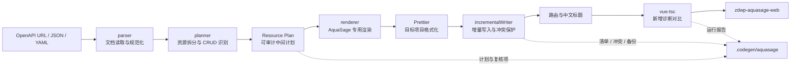

# Swagger to Codegen

> 面向 `zdwp-aquasage-web` 的 OpenAPI CRUD 前端代码生成工具

`swagger-to-codegen` 将 Swagger/OpenAPI 契约转换为 `zdwp-aquasage-web` 可直接使用的 API、类型、字段配置和 Vue 页面。项目的目标不是做一套适配所有前端工程的通用生成器，而是把 AquaSage“工程名录”等高度重复的 CRUD 开发流程固化为命令行工具。

| 项目属性 | 当前说明                                                           |
| -------- | ------------------------------------------------------------------ |
| 服务对象 | `zdwp-aquasage-web`                                                |
| 核心场景 | 工程名录及同结构业务资源的 CRUD 页面                               |
| 主要输入 | OpenAPI 3.x / Swagger 2.0，支持 URL、本地 JSON 和 YAML             |
| 主要输出 | Service API、TypeScript 类型、字段配置、列表页、详情页、可选附件页 |
| 推荐命令 | `aquasage`                                                         |
| 设计原则 | 能由契约和项目规范确定的内容全部由脚本生成                         |
| LLM 依赖 | AquaSage 主流程不依赖；参考模板实验流程依赖                        |
| 当前版本 | `3.0.0`                                                            |
| Node.js  | `>= 20.19.0`                                                       |

## 1. 项目背景与目标

### 1.1 要解决的问题

`zdwp-aquasage-web` 中存在大量结构相同的 CRUD 页面。它们通常共享：

- 相同的工程目录和路由层级；
- 相同的请求封装、分页表格和表单组件；
- 相同的新增、编辑、详情、删除交互；
- 相同的代码风格和类型命名空间；
- 不同的业务接口、业务字段、标题和少量能力开关。

手工复制页面再替换字段容易产生接口漏改、类型缺失、分页路径错误、路由标题遗漏和覆盖人工代码等问题。

### 1.2 项目目标

本项目把可重复工作转换为一条可审计的生成流水线：

```text
OpenAPI 契约
  → 识别业务资源
  → 判断 CRUD 能力
  → 推导字段、分页和响应路径
  → 按 AquaSage 目录与组件约定渲染
  → 格式化、增量写入、路由处理、类型检查
  → 得到可直接进入业务项目的代码
```

### 1.3 项目边界

- 生成规范以 `zdwp-aquasage-web` 为唯一目标，不为其他项目牺牲目录、组件或调用约定。
- `aquasage` 是生产使用的主流程，采用确定性渲染，不调用 LLM。
- `style`、`page`、`generate` 是保留的“参考模板 + LLM”辅助流程，不是 AquaSage 工程名录的首选方案。
- 当前专用渲染器聚焦 `knowledge-engineering/engineering-catalog` 下的 CRUD 页面。

## 2. 核心价值

| 传统方式                   | 使用本工具                         |
| -------------------------- | ---------------------------------- |
| 复制已有页面后逐项替换     | 从 OpenAPI 自动识别接口和字段      |
| 人工编写 API 与类型        | 自动生成并闭包补齐引用类型         |
| 人工判断分页数据路径       | 自动分析 records 与 total 路径     |
| 人工新增字段配置和表单校验 | 根据 Schema 生成控件与校验         |
| 人工维护路由标题           | 支持配置式路由和 i18n 路由两种方案 |
| 重复执行可能覆盖人工修改   | 基于哈希识别冲突，默认保留人工文件 |
| 只能看到最终文件           | 保留计划、清单、备份和运行报告     |

一次完整的 AquaSage 资源生成通常可产出 5 个文件；启用且满足附件条件时产出 6 个文件。

## 3. 总体架构



### 3.1 分层说明

| 层级            | 核心模块                                                          | 职责                                                    |
| --------------- | ----------------------------------------------------------------- | ------------------------------------------------------- |
| CLI 层          | `codegen.js`                                                      | 定义命令、参数校验、组织执行流程                        |
| 契约层          | `lib/parser.js`                                                   | 读取远程或本地文档，兼容 JSON/YAML、OpenAPI/Swagger     |
| 通用生成层      | `generator.js`、`contractAnalyzer.js`、`uiPlanner.js`             | API、类型、CRUD 证据和通用 UI Plan                      |
| AquaSage 规划层 | `lib/aquasage/planner.js`                                         | 按稳定资源路径拆分接口并建立资源计划                    |
| AquaSage 渲染层 | `lib/aquasage/renderer.js`                                        | 输出符合目标项目约定的 service、typing、配置和 Vue 页面 |
| 工程集成层      | `projectGenerator.js`、`routePatcher.js`、`localeSynchronizer.js` | 写入目标工程、处理两种路由版本、生成报告                |
| 质量保障层      | `incrementalWriter.js`、`validator.js`、`formatCode.js`           | 路径保护、冲突检测、备份、格式化和类型诊断              |
| LLM 辅助层      | `styleAnalyzer.js`、`pageGenerator.js`                            | 分析参考模板、生成实验性页面并限次修复                  |

### 3.2 两条执行链

#### A. AquaSage 专用确定性链路（推荐）

```text
aquasage
  ├─ parser
  ├─ AquaSage planner
  ├─ AquaSage renderer
  ├─ incremental writer
  ├─ route patch / route generation
  └─ vue-tsc diagnostic diff
```

特点：不使用 LLM、输出稳定、目录固定、适合直接写入 `zdwp-aquasage-web`。

#### B. 通用模板辅助链路（保留能力）

```text
api / analyze / plan
  → API + 模块类型 + UI Plan
  → style / page / generate
  → 参考模板 + LLM 页面
```

特点：适合验证模板生成思路；页面表达依赖模型输出，稳定性低于专用链路。

## 4. 工作原理

### 4.1 契约读取与规范化

`loadSwagger` 根据输入自动选择读取方式：

- `http://` 或 `https://`：通过网络读取，超时时间 15 秒；
- 本地文件：直接读取文件内容；
- JSON：按 JSON 解析；
- `.yaml`、`.yml` 或 YAML 内容：按 YAML 解析；
- 同时支持 OpenAPI 3 的 `components.schemas` 和 Swagger 2 的 `definitions`；
- 合并 path 级与 operation 级参数；
- 兼容 Swagger 2 的 body 参数和 OpenAPI 3 的 `requestBody`；
- 从第一个 2xx 响应中提取响应 Schema。

### 4.2 业务资源拆分

一个 Swagger tag 可能包含多个业务实体，因此 AquaSage 主流程不会简单地把一个 tag 当成一个页面。规划器会去掉路径末尾的动作段，例如：

```text
/api/v1/hyo/river/page
/api/v1/hyo/river/detail
/api/v1/hyo/river/update
/api/v1/hyo/river/delete
```

这些接口会归并为稳定资源：

```text
/api/v1/hyo/river
```

因此，“水体相关”一个 tag 可以继续拆分为 `river`、`lake`、`fish-survey` 等多个独立页面。

### 4.3 CRUD 能力识别

规划器综合以下证据为每个资源选择 list、detail、create、update、delete 接口：

- HTTP 方法；
- URL 末段；
- `operationId`；
- summary/description 关键词；
- 是否包含路径参数或详情查询参数。

列表接口是专用页面生成的最低要求。其他接口缺失时会输出复核警告，并在页面中省略对应的 API 能力或操作。

### 4.4 Schema 到 UI 计划

脚本继续从请求和响应 Schema 推导：

- 查询条件：来自列表接口的 query 参数，排除分页、排序等系统参数；
- 表格字段：来自列表响应项，优先常用业务字段并限制展示数量；
- 表单字段：来自新增或更新请求体，排除 id、时间戳、版本等系统字段；
- 控件类型：enum → select、boolean → switch、date → 日期控件、number → 数字控件、长文本 → textarea；
- 特殊字段：`city_code`、`area_code` 使用 AquaSage 树形区域控件约定；
- 校验规则：required、长度、数值范围和 pattern；
- 分页参数：识别 current/page/page_num 与 size/page_size/limit；
- 响应路径：识别 data/result/payload 包装以及 records/rows/list/items/content、total/count 等结构；
- 详情主键：优先 `project_code`、`std_code`、`id`、`code`。

计划会保存到 `.codegen/aquasage/plans/<slug>.json`，便于检查脚本为何生成某个字段或调用。

### 4.5 AquaSage 专用渲染

渲染器不复制任意项目模板，而是固定使用 `zdwp-aquasage-web` 的工程约定：

- `@/service/request` 请求体系；
- `Api.EngineeringCatalog` 类型命名空间；
- `EngineeringForm` 等公共组件；
- `useNaivePaginatedTable` 等现有 composable；
- `knowledge-engineering/engineering-catalog` 路由与页面层级。

这也是生成结果能够直接进入目标项目的关键。

### 4.6 写入与校验

正式生成时依次执行：

1. 验证目标项目 `package.json.name === "zdwp-aquasage-web"`；
2. 检查请求封装、公共表单组件和列表 composable 等项目标志文件；
3. 使用目标文件所在项目的 Prettier 配置格式化；
4. 记录生成前的 `vue-tsc` 错误基线；
5. 通过增量写入器创建、更新或保护文件；
6. 按目标项目版本处理路由；
7. 保存资源计划和运行报告；
8. 再次运行 `vue-tsc`，只拦截本次新增的类型错误。

## 5. 项目目录

```text
swagger-to-codegen/
├─ codegen.js                         # 统一 CLI 入口，推荐使用
├─ index.js                           # 早期单一 API 生成入口，保留兼容，不推荐
├─ lib/
│  ├─ parser.js                       # OpenAPI/Swagger 读取与标准化
│  ├─ generator.js                    # 通用 API 与 TypeScript 类型生成
│  ├─ contractAnalyzer.js             # CRUD 角色、证据、置信度与覆盖率
│  ├─ uiPlanner.js                    # 通用确定性 UI Plan
│  ├─ incrementalWriter.js            # 哈希基线、冲突、备份、原子写入
│  ├─ extractSkeletonFromFiles.js     # 从 API 和模块类型提取页面骨架
│  ├─ styleAnalyzer.js                # LLM 分析参考页面风格
│  ├─ pageGenerator.js                # LLM 页面生成与限次修复
│  ├─ formatCode.js                   # Vue 格式化与临时类型检查
│  └─ aquasage/
│     ├─ planner.js                   # AquaSage 资源计划
│     ├─ renderer.js                  # AquaSage 文件渲染
│     ├─ projectGenerator.js          # 专用生成总流程
│     ├─ validator.js                 # 目标工程及类型诊断
│     ├─ routePatcher.js              # route-titles/menu-config 路由版本
│     └─ localeSynchronizer.js        # Elegant Router + zh-cn i18n 版本
├─ templates/List.vue                 # 示例参考模板
├─ test/                              # Node.js 自动化测试
├─ docs/
│  ├─ deterministic-pipeline.md       # 确定性流水线设计说明
│  └─ patent-technical-disclosure.md  # 技术交底材料
├─ style-guide.yaml                   # 示例风格规范
└─ package.json                       # 包信息与 aquasage-codegen 命令注册
```

## 6. AquaSage 生成结果

以资源 `river` 为例，`aquasage` 会直接写入目标项目：

```text
zdwp-aquasage-web/
├─ src/service/api/engineering-catalog/river.ts
├─ src/typings/api/engineering-catalog/river.d.ts
├─ src/config/engineering/river-fields.ts
└─ src/views/knowledge-engineering/engineering-catalog/river/
   ├─ list/index.vue
   ├─ detail/index.vue
   └─ attachment/index.vue            # 仅启用且存在引用字段时生成
```

同时生成审计元数据：

```text
zdwp-aquasage-web/.codegen/
├─ manifest.json
├─ reports/
├─ conflicts/
├─ backups/
└─ aquasage/
   ├─ plans/
   ├─ reports/
   └─ backups/
```

`.codegen` 不属于业务源码，但它是增量生成的可信基线，不建议删除。

## 7. 快速开始

### 7.1 环境准备

```powershell
# 进入工具项目
cd "D:\workCode\A-大模型开发\前端CRUD智能自动化工具\swagger-to-codegen"

# 安装依赖
npm install

# 检查 CLI
node .\codegen.js --help
```

目标 `zdwp-aquasage-web` 应先安装自身依赖；否则路由生成或 `vue-tsc` 检查可能无法执行。

### 7.2 两种调用方式

| 使用场景                     | 命令前缀                     |
| ---------------------------- | ---------------------------- |
| 在工具源码目录运行           | `node .\codegen.js`          |
| 作为依赖安装到业务项目后运行 | `pnpm exec aquasage-codegen` |

下文统一使用源码方式。改为包方式时，只需替换命令前缀，子命令和参数保持不变。

### 7.3 第一步：只预览，不写文件

```powershell
node .\codegen.js aquasage `
  -s "http://10.10.1.206:8000/api/v1/openapi.json" `
  -p "D:\workCode\知识库\zdwp-aquasage-web" `
  -m "水体相关" `
  --dry-run
```

重点检查：

- 识别出的资源数量和 slug；
- 每个资源的基础路径；
- 缺少 detail/create/update/delete 等复核警告；
- 将要写入的文件清单；
- 是否需要附件页。

### 7.4 第二步：生成业务代码

如果目标项目使用 `src/locales/langs/zh-cn.ts`，先跳过旧版路由补丁：

```powershell
node .\codegen.js aquasage `
  -s "http://10.10.1.206:8000/api/v1/openapi.json" `
  -p "D:\workCode\知识库\zdwp-aquasage-web" `
  -m "水体相关" `
  --no-routes
```

### 7.5 第三步：生成路由并同步中文标题

```powershell
node .\codegen.js sync-zh-cn `
  -s "http://10.10.1.206:8000/api/v1/openapi.json" `
  -p "D:\workCode\知识库\zdwp-aquasage-web" `
  -m "水体相关"
```

该命令完全由脚本执行，不调用 LLM。它会：

1. 在目标项目执行 `pnpm exec sa gen-route`；
2. 从 `src/router/elegant/routes.ts` 读取实际 `i18nKey`；
3. 在 `src/locales/langs/zh-cn.ts` 中补充中文标题；
4. 更新空值或仍等于路由 key 的占位标题；
5. 默认保留已经人工修改的中文标题；
6. 修改前备份原文件并生成 JSON 报告。

### 7.6 第四步：人工验收

建议进入目标项目执行：

```powershell
git status --short
git diff
pnpm typecheck
pnpm dev
```

具体脚本名以目标项目 `package.json` 为准。至少检查页面字段、分页、详情主键、增删改按钮、路由标题和权限。

## 8. 路由版本选择

AquaSage 项目在不同阶段存在两种路由组织方式。执行前先看目标项目实际文件。

| 目标项目特征                                                        | 处理方式                                             |
| ------------------------------------------------------------------- | ---------------------------------------------------- |
| 存在 `src/router/route-titles.ts` 和 `menu-config.ts`               | 直接运行 `aquasage`，默认补丁后执行 `pnpm gen-route` |
| 存在 `src/locales/langs/zh-cn.ts` 和 `src/router/elegant/routes.ts` | 运行 `aquasage --no-routes`，再运行 `sync-zh-cn`     |

### 8.1 配置式路由版本

```powershell
node .\codegen.js aquasage `
  -s ".\openapi.json" `
  -p "D:\workCode\知识库\2026-08-10-1\zdwp-aquasage-web" `
  --resource "/api/v1/prj/pumping-station" `
  --title "泵站"
```

默认会向：

- `src/router/route-titles.ts` 写入父级、列表、详情和可选附件标题；
- `src/router/menu-config.ts` 写入子页隐藏与 `activeMenu` 配置；
- 然后执行目标项目的 `pnpm gen-route`。

### 8.2 i18n 路由版本

```powershell
# 1. 生成业务文件，不碰旧版路由配置
node .\codegen.js aquasage `
  -s ".\openapi.json" `
  -p "D:\workCode\知识库\zdwp-aquasage-web" `
  --slug "pumping-station" `
  --title "泵站" `
  --no-routes

# 2. 生成 Elegant Router 路由并同步 zh-cn.ts
node .\codegen.js sync-zh-cn `
  -s ".\openapi.json" `
  -p "D:\workCode\知识库\zdwp-aquasage-web" `
  --slug "pumping-station" `
  --title "泵站"
```

如果误用默认 `aquasage` 并看到以下错误：

```text
ENOENT: no such file or directory, open '...\src\router\route-titles.ts'
```

它表示业务代码已生成到写入阶段，但目标项目不是 `route-titles.ts` 路由版本。改用 `--no-routes`，再执行 `sync-zh-cn`。当前流程不会因为路由后处理失败而自动回滚已经生成的业务文件，因此还应检查 `git status` 和 `.codegen` 报告。

## 9. 命令总览

| 命令         | 是否使用 LLM             | 用途                                  | 推荐程度      |
| ------------ | ------------------------ | ------------------------------------- | ------------- |
| `aquasage`   | 否                       | 直接生成 AquaSage 工程名录 CRUD       | 主流程        |
| `sync-zh-cn` | 否                       | Elegant Router 路由生成与中文标题同步 | i18n 项目必需 |
| `analyze`    | 否                       | 输出 CRUD 识别证据和覆盖率            | 生成前审计    |
| `plan`       | 否                       | 输出通用字段、控件、校验和分页计划    | 调试/审计     |
| `api`        | 否；带模板时页面阶段使用 | 生成通用 API、模块类型和 UI Plan      | 辅助          |
| `style`      | 是                       | 从参考页面提取风格规范                | 实验流程      |
| `page`       | 是                       | 根据已有 API、UI Plan 和模板生成页面  | 实验流程      |
| `generate`   | 是                       | 串联通用 API、风格分析和页面生成      | 实验流程      |

查看全部帮助：

```powershell
node .\codegen.js --help
node .\codegen.js aquasage --help
```

## 10. 命令使用说明

### 10.1 `aquasage`：生成 AquaSage CRUD

必须显式使用 `--resource`、`--module`、`--slug` 或 `--all`，避免误生成整个 Swagger。

#### 按 Swagger tag 生成多个资源

```powershell
node .\codegen.js aquasage `
  -s ".\openapi.json" `
  -p "D:\workCode\知识库\zdwp-aquasage-web" `
  -m "水体相关" `
  --no-routes
```

#### 精确生成一个资源

```powershell
node .\codegen.js aquasage `
  -s ".\openapi.json" `
  -p "D:\workCode\知识库\zdwp-aquasage-web" `
  --resource "/api/v1/hyo/river" `
  --title "河流" `
  --no-routes
```

#### 生成附件页

```powershell
node .\codegen.js aquasage `
  -s ".\openapi.json" `
  -p "D:\workCode\知识库\zdwp-aquasage-web" `
  --slug "river" `
  --title "河流" `
  --with-attachment `
  --no-routes
```

只有列表项包含 `std_code` 或 `project_code` 时附件页才会启用。`--title` 建议只与单资源的 `--resource` 或 `--slug` 一起使用，避免给同一 tag 下多个资源设置相同标题。

常用开关：

| 参数                    | 作用                                      |
| ----------------------- | ----------------------------------------- |
| `--dry-run`             | 只验证、规划和格式化，不写目标项目        |
| `--with-attachment`     | 满足引用字段条件时生成附件页              |
| `--no-routes`           | 不修改路由配置，也不执行路由生成          |
| `--no-route-generation` | 仍修改路由配置，但不执行 `pnpm gen-route` |
| `--no-check`            | 跳过生成前后 `vue-tsc` 诊断对比           |
| `--force`               | 备份人工文件后强制覆盖                    |

### 10.2 `sync-zh-cn`：检查并修改中文路由标题

#### 同步一个 tag

```powershell
node .\codegen.js sync-zh-cn `
  -s ".\openapi.json" `
  -p "D:\workCode\知识库\zdwp-aquasage-web" `
  -m "水体相关"
```

#### 只检查现有路由，不写文件

```powershell
node .\codegen.js sync-zh-cn `
  -s ".\openapi.json" `
  -p "D:\workCode\知识库\zdwp-aquasage-web" `
  -m "水体相关" `
  --dry-run
```

`--dry-run` 不执行路由生成，因此此时 `src/router/elegant/routes.ts` 必须已经是最新状态。

#### 批量覆盖自动推断标题

创建 `zh-cn-titles.json`：

```json
{
  "fish-survey": "鱼类调查",
  "river": "河流",
  "other-water": "其他水体",
  "lake": "湖泊",
  "qsc-circle": "QSC圈层",
  "hyo": "水体综合数据"
}
```

然后执行：

```powershell
node .\codegen.js sync-zh-cn `
  -s ".\openapi.json" `
  -p "D:\workCode\知识库\zdwp-aquasage-web" `
  -m "水体相关" `
  --titles ".\zh-cn-titles.json"
```

默认不会覆盖已有人工中文标题；只有确认需要覆盖时才添加 `--force`。

如果附件页已通过 `aquasage --with-attachment` 生成，同步标题时也应添加 `--with-attachment`。使用 `--no-route-generation` 可以跳过 `pnpm exec sa gen-route`，直接检查当前已有的 `routes.ts`。

### 10.3 `analyze`：分析 CRUD 契约

```powershell
node .\codegen.js analyze `
  -s ".\openapi.json" `
  -o ".\codegen-plan.json"
```

输出 `codegen-plan.json`，包含：

- 模块和接口数量；
- 每个接口推断的 CRUD 角色；
- HTTP 方法、关键词和路径参数等证据；
- 置信度及是否需要人工复核；
- 每个模块的 CRUD 覆盖率。

### 10.4 `plan`：生成确定性 UI Plan

```powershell
node .\codegen.js plan `
  -s ".\openapi.json" `
  -m "水体相关" `
  -o ".\ui-plan-hyo.json"
```

输出包含 API 绑定、查询字段、表格字段、表单字段、控件、校验、分页参数、响应路径和禁止虚构字段等约束。

### 10.5 `api`：仅生成通用 API 和模块类型

```powershell
node .\codegen.js api `
  -s ".\openapi.json" `
  -m "水体相关" `
  -o ".\src\api"
```

输出示例：

```text
src/api/
├─ modules/hyo.ts
├─ types/hyo.d.ts
└─ .codegen/
   ├─ manifest.json
   ├─ ui-plan.json
   └─ reports/
```

每个模块拥有独立类型文件。例如 `modules/hyo.ts` 从 `../types/hyo` 导入，避免不同模块共享或覆盖旧的 `types/api.d.ts`。类型生成会递归补齐 `$ref` 引用闭包，包括 FastAPI nullable 包装中的引用。

`api` 也支持通过 `-t` 直接进入模板页面阶段，但为了排查问题和保留清晰边界，建议先执行 `api`，再单独执行 `page`。

### 10.6 `style`：分析参考页面风格

此命令使用 LLM。

```powershell
node .\codegen.js style `
  "D:\ref-project\list\index.vue" `
  -o ".\style-guide.yaml"
```

输出的 YAML 描述列表页、表单、详情页、增删改流程和路由模式。它只应提供页面表达风格，不能替代 OpenAPI 中的业务字段和 API 事实。

### 10.7 `page`：基于已有 API 生成页面

此命令使用 LLM；用户提出的以下形式是有效命令：

```powershell
node .\codegen.js page `
  --api-file ".\src\api\modules\policy.ts" `
  -t "D:\ref-project\list\index.vue" `
  -o ".\src\views"
```

完整示例：

```powershell
node .\codegen.js page `
  --api-file ".\src\api\modules\hyo.ts" `
  --style-guide ".\style-guide.yaml" `
  -t "D:\ref-project\list\index.vue" `
  --form-template "D:\ref-project\detail\index.vue" `
  --ui-plan ".\src\api\.codegen\ui-plan.json" `
  --api-import-path "@/api/modules" `
  -o ".\src\views"
```

预期输出：

```text
src/views/hyo/
├─ list/index.vue
└─ detail/index.vue
```

骨架提取器优先读取与 API 同名的类型文件，例如 `modules/hyo.ts` 对应 `types/hyo.d.ts`，仅在必要时回退到旧的 `types/api.d.ts`。

### 10.8 `generate`：通用模板全流程

此命令使用 LLM。

```powershell
node .\codegen.js generate `
  -s ".\openapi.json" `
  -m "政策相关" `
  -t "D:\ref-project\list\index.vue" `
  --form-template "D:\ref-project\detail\index.vue" `
  --style-guide ".\style-guide.yaml" `
  --api-output ".\src\api" `
  --api-import-path "@/api/modules" `
  -o ".\src\views"
```

执行顺序：

1. 生成 API、模块类型和 UI Plan；
2. 使用已有风格规范，或从参考模板分析生成；
3. 从 API 与类型文件提取页面骨架；
4. 调用 LLM 生成 Vue 文件；
5. 使用临时文件运行 `vue-tsc`；
6. 最多进行 3 次 LLM 定向修复；
7. 通过增量写入策略落盘。

## 11. LLM 配置

只有 `style`、`page`、`generate`，以及 `api -t` 的页面阶段需要 LLM。AquaSage 专用主流程、中文标题同步、契约分析、UI 计划和纯 API 生成均不需要。

在工具根目录创建 `.env`：

```dotenv
OPENAI_API_KEY=your_api_key
OPENAI_BASE_URL=https://your-openai-compatible-endpoint/v1
OPENAI_MODEL=your_model_name
LLM_TEMPERATURE=0.1
```

请勿提交 `.env`。模型服务需要兼容 OpenAI Chat API。

`OPENAI_MODEL` 和 `LLM_TEMPERATURE` 用于页面生成器；当前风格分析器默认使用 `deepseek-v4-pro`。如果团队更换模型服务，应先用一组参考模板验证 `style/page/generate` 链路，AquaSage 确定性主流程不受影响。

## 12. 增量生成与人工代码保护

生成器不会把“文件存在”直接理解为“可以覆盖”。每个文件都会与上一次机器生成哈希比较：

| 当前状态                       | 写入动作                                                  |
| ------------------------------ | --------------------------------------------------------- |
| 文件不存在                     | `created`：创建文件并记录生成哈希                         |
| 当前内容与新结果一致           | `unchanged`：不重复写入                                   |
| 当前内容仍等于上次机器生成版本 | `updated`：安全更新                                       |
| 当前内容偏离机器基线           | `conflict`：保留人工文件，将候选写入 `.codegen/conflicts` |
| 显式使用 `--force`             | `forced`：先备份到 `.codegen/backups`，再覆盖             |

其他保护机制：

- 生成目标必须位于配置的输出根目录内；
- 禁止把业务文件写入 `.codegen` 元数据目录；
- 使用临时文件 + rename 原子写入；
- 路由和中文文件修改前单独备份；
- 每次执行生成 JSON 报告。

不要删除 `manifest.json` 来绕过冲突。缺少可信基线的已有文件会按人工文件处理。

## 13. 质量保障

### 13.1 自动检查

```powershell
npm run check
npm test
```

当前测试覆盖：

- 同 tag 多资源拆分；
- AquaSage 分页、详情键、区域字段和附件约定；
- 专用目录与渲染结果；
- dry-run 不写文件；
- 重复生成幂等；
- 路由配置补丁和备份；
- 路径参数、返回类型和类型导入；
- 传递型 `$ref` 与 FastAPI nullable 类型闭包；
- 模块独立类型文件；
- CRUD 证据与 UI Plan；
- 人工修改冲突和强制覆盖备份；
- i18n 路由 key 提取、`zh-cn.ts` 更新、保留人工标题和 dry-run。

当前基线共 24 个自动化测试。

### 13.2 生成结果检查

`aquasage` 默认使用“前后诊断差异”而不是要求目标项目原本零错误：

```text
生成前 vue-tsc 错误集合
          ↓
生成文件并处理路由
          ↓
生成后 vue-tsc 错误集合
          ↓
只报告本次新增错误
```

这样可以避免目标项目已有历史错误掩盖本次生成质量，也不会把历史问题误判成生成失败。

## 14. 常见问题

### 14.1 为什么已经生成文件，最后仍报 `route-titles.ts` 不存在？

业务文件写入发生在路由补丁之前。该错误表示目标项目使用另一种路由结构，不表示前面的业务文件未生成。请按“8.2 i18n 路由版本”的两条完整命令重新执行：生成业务代码时添加 `--no-routes`，随后通过 `sync-zh-cn` 生成路由并同步标题。

### 14.2 为什么一个 tag 生成多个页面？

因为 tag 只是接口分组，不一定等于业务资源。`aquasage` 会继续按照稳定 URL 基础路径拆分资源，这是预期行为。

### 14.3 为什么有“缺少 detail/create/update/delete”警告？

规划器没有从该资源的契约中找到足够匹配的接口。生成器不会虚构 API，会保留列表等已识别能力并提示复核 OpenAPI。

### 14.4 为什么类型文件是 `types/hyo.d.ts`，不是 `types/api.d.ts`？

当前通用 API 流程采用模块独立类型文件。API 文件名和类型文件名保持一致，从根源上避免不同 tag 的类型被后一次生成覆盖。

### 14.5 为什么生成结果进入 `conflicts`，没有覆盖页面？

目标文件与上次机器生成基线不同，说明它可能被人工修改。检查候选文件和 diff；只有确认可覆盖时才重新执行并添加 `--force`。

### 14.6 内网 Swagger 无法访问怎么办？

先将 OpenAPI 下载为本地 `json` 或 `yaml`，再把 `-s` 指向本地文件：

例如，可先用本地契约运行分析命令确认文件有效：

```powershell
node .\codegen.js analyze -s ".\openapi.json" -o ".\codegen-plan.json"
```

### 14.7 为什么附件页没有生成？

必须同时使用 `--with-attachment`，并且列表项 Schema 中存在 `std_code` 或 `project_code`。

### 14.8 如何覆盖错误的中文业务标题？

单资源使用 `--slug/--resource + --title`；多个资源使用 `sync-zh-cn --titles <json-file>`。默认保留已有人工翻译。

## 15. 作为团队工具使用

`package.json` 已注册命令：

```json
{
  "bin": {
    "aquasage-codegen": "./codegen.js"
  }
}
```

### 15.1 本地打包并分享

在工具项目中：

```powershell
npm run check
npm test
npm pack
```

将生成的 `swagger-to-codegen-3.0.0.tgz` 发给小组成员。成员在自己的 `zdwp-aquasage-web` 中安装：

```powershell
pnpm add -D "D:\packages\swagger-to-codegen-3.0.0.tgz"
```

然后从业务项目根目录执行：

```powershell
pnpm exec aquasage-codegen aquasage `
  -s ".\openapi.json" `
  -p "." `
  --slug "river" `
  --title "河流" `
  --no-routes

pnpm exec aquasage-codegen sync-zh-cn `
  -s ".\openapi.json" `
  -p "." `
  --slug "river" `
  --title "河流"
```

也可以把同一个包发布到公司 npm 私服。团队成员只需安装固定版本，命令保持不变。

## 16. 汇报摘要

可以用下面四句话介绍本项目：

1. `swagger-to-codegen` 是为 `zdwp-aquasage-web` 定制的 OpenAPI CRUD 自动化工具。
2. 它把接口、类型、字段、分页、页面、路由和校验串成一条命令行流水线。
3. 主流程采用确定性脚本，LLM 不参与 API、字段、分页路径和文件覆盖等关键决策。
4. 通过 dry-run、哈希冲突检测、强制覆盖前备份、运行报告和新增类型诊断对比，保证生成过程可预览、可审计、可重复。

### 当前实现成果

- 已形成 AquaSage 专用的资源规划器和代码渲染器；
- 支持一个 Swagger tag 自动拆分为多个稳定业务资源；
- 可一次生成 service、typing、字段配置、列表、详情和附件页面；
- 支持配置式路由与 Elegant Router i18n 两种目标版本；
- 实现模块独立类型和传递引用闭包，解决 API 引用类型未定义问题；
- 实现增量生成、人工修改保护、备份与报告；
- 已建立覆盖核心生成行为的自动化测试。

## 17. 进一步阅读

- `docs/deterministic-pipeline.md`：为什么优先使用确定性脚本，以及 LLM 的职责边界。
- `docs/patent-technical-disclosure.md`：更完整的技术方案和创新点说明。

## License

ISC
